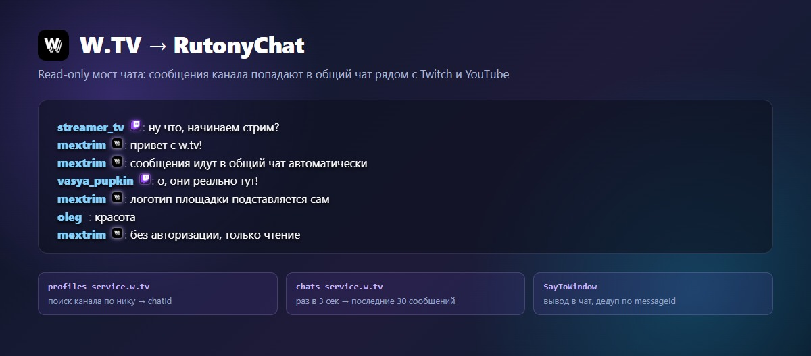

# rutonychat-wtv-script

[](https://github.com/Mextrim/rutonychat-wtv-script/releases)
[](LICENSE)
[](https://store.steampowered.com/app/524660/)

Мост чата W.TV для [RutonyChat](https://store.steampowered.com/app/524660/).

RutonyChat не умеет W.TV нативно: площадки нет ни в списке платформ, ни в
`SiteEnum`. Этот автономный скрипт закрывает дыру — забирает сообщения
канала и выводит их в общий чат рядом с Twitch и YouTube.

**Строго READ-ONLY:** не вступает в чат, не открывает realtime-сокет,
ни на что не подписывается. Авторизация не нужна.



> Изображение — рендер на демонстрационных сообщениях, не запись реального стрима.

---

## Установка

**[⬇ Скачать wtv-script-1.0.0.zip](https://github.com/Mextrim/rutonychat-wtv-script/releases/download/v1.0.0/wtv-script-1.0.0.zip)** ·
[все релизы](https://github.com/Mextrim/rutonychat-wtv-script/releases)

1. Скопируйте `wtv.cs` в `<RutonyChat>/scripts/`
2. **Автономные скрипты → wtv → Параметры:**

```json
{"nickname":"mextrim"}
```

3. Нажмите **«Переподключить»**

`nickname` — канал на W.TV, то, что после `w.tv/` в адресе.
Открывать сайт не нужно: канал ищется по нику через `profiles-service.w.tv`.

Требуется только интернет.

Скрипт также доступен в мастерской Steam.

---

## Как это работает

Два анонимных запроса:

```
1) GET profiles-service.w.tv/api/v1/profiles/by-nickname/{nick}?platform=web
     -> { profile: { userId } }        userId и есть chatId

2) GET chats-service.w.tv/api/v1/chats/{chatId}/messages?limit=30&platform=web
     -> { messages: [ { messageId, type, content,
                        sender: { userId, nickname, tags[] },
                        createdAt } ] }
```

Каждые **3 секунды** забираются последние 30 сообщений. Дубликаты отсекаются
по `messageId` (буфер на 400 id). При старте скрипт запоминает последние
сообщения и не вываливает историю. При потере связи — автоперезапуск
с нарастающей паузой.

Диагностика пишется в `<RutonyChat>/scripts/wtv.log`.
Строка `+N message(s)` означает, что скрипт поймал новые сообщения.

---

## Почему REST-поллинг, а не WebSocket

Реальный транспорт W.TV — Centrifugo (`wss://ws.w.tv/connection/websocket`).
Он режет подключения из .NET по **TLS-отпечатку** и отдаёт `403` — Cloudflare
bot management отсекает не заголовки, а сам handshake. REST API не заблокирован,
поэтому скрипт опрашивает список сообщений вместо сокета.

**Задержка около 3 секунд** вместо мгновенной доставки — плата за обход.

---

## Отметка площадки в чате

`SayToWindow` не принимает `SiteEnum`, поэтому площадку штатно передать
в чат нельзя. Скрипт добавляет в никнейм невидимый маркер `\u200Dwtv\u200D`
(zero-width joiner) — на экране он не виден, но тема его распознаёт.

Тема [`minimal-chat`](https://github.com/Mextrim/rutonychat-minimal-chat)
снимает маркер и подставляет официальный логотип W.TV.

---

## Ограничения

| Ограничение | Почему |
|---|---|
| Задержка ~3 секунды | REST-поллинг вместо WebSocket |
| Нет бейджа площадки | `SayToWindow` не принимает `SiteEnum` |
| Отправка сообщений не работает | W.TV требует авторизацию для записи, анонимный POST даёт `BAD_REQUEST_ERROR` |

В коде есть заготовка отправки: если передать `token`, скрипт будет
пересылать сообщения с префиксом в W.TV.

```json
{"nickname":"mextrim","token":"...","forwardPrefix":"!wtv"}
```

Без токена мост остаётся строго read-only. На момент публикации путь отправки
не работает — W.TV отвергает любые анонимные запросы записи.

---

## Лицензия

MIT — см. [LICENSE](LICENSE).
